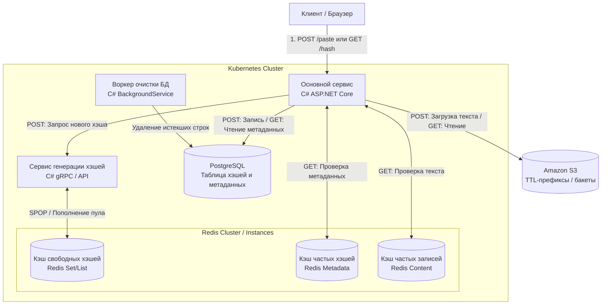
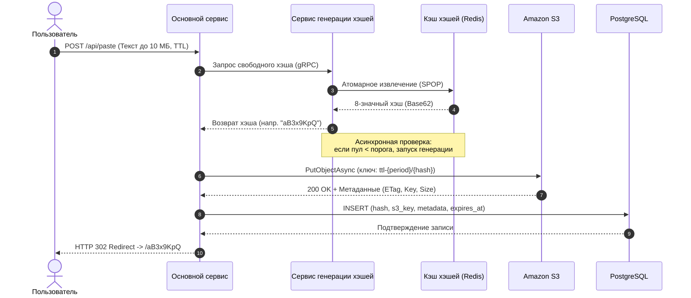
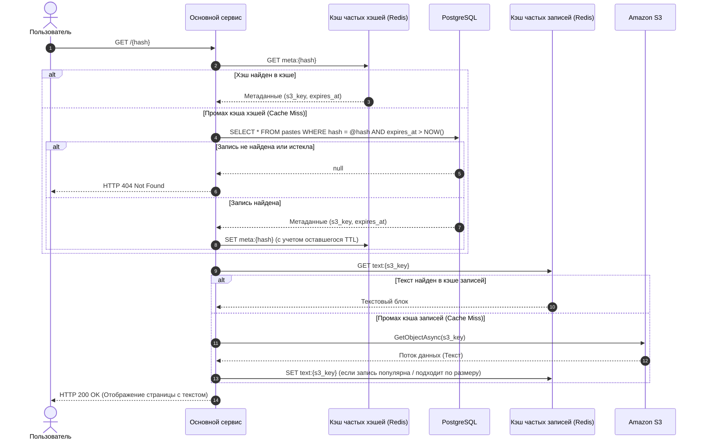

# Архитектура системы Pastebin

## 1. Общее описание системы

Система представляет собой высокопроизводительный сервис для временного хранения и обмена текстовыми блоками (до $10\text{ МБ}$) по коротким уникальным ссылкам без необходимости авторизации пользователей. 

### Ключевые параметры:
* **Максимальный размер записи:** $10\text{ МБ}$.
* **Формат ссылки:** `/hash_code` (8 символов, кодировка Base62: `[a-zA-Z0-9]`).
* **Емкость пространства ключей:** $62^8 \approx 2.18 \times 10^{14}$ уникальных комбинаций.
* **Стек технологий:**
  * **Backend:** C# (.NET 8 / ASP.NET Core Minimal API, gRPC, BackgroundServices)
  * **Frontend:** Легковесный клиент (Razor Pages или статический HTML/JS), раздаваемый основным сервисом
  * **База данных:** PostgreSQL
  * **Кэширование:** Redis
  * **Объектное хранилище:** Amazon S3 (или S3-совместимое хранилище MinIO для локальной разработки)
  * **Оркестрация и инфраструктура:** Docker, Kubernetes (K8s)

---

## 2. Компоненты архитектуры

1. **Основной сервис (`Pastebin.MainService`):**
   * Принимает HTTP-запросы от клиентов (`POST` на создание, `GET` на чтение).
   * Координирует синхронный пайплайн сохранения данных и многоуровневое чтение.
   * Отдает простую веб-страницу для ввода и просмотра текста.
2. **Сервис генерации хэшей (`Pastebin.HashService`):**
   * Генерирует уникальные 8-значные хэши по алгоритму Base62.
   * Управляет собственным кэшем предсгенерированных хэшей в Redis.
   * Обеспечивает потокобезопасную выдачу хэшей при многопоточных запросах от нескольких реплик основного сервиса.
   * В фоновом режиме отслеживает уровень заполненности кэша хэшей и догенерирует новые пачки при падении ниже порогового значения.
3. **Кэш сервиса генерации хэшей (Redis — Hash Pool):**
   * Хранит пул готовых к выдаче свободных хэшей.
4. **База данных (PostgreSQL):**
   * Хранит связку сгенерированного хэша, времени жизни записи и метаданных объекта в S3.
5. **Кэш часто используемых хэшей (Redis — Metadata Cache):**
   * Хранит метаданные записей (`s3_key`, `expires_at`, размер и т.д.) по ключу `meta:{hash}` для снижения нагрузки на PostgreSQL.
6. **Кэш часто используемых записей (Redis — Content Cache):**
   * Хранит непосредственно текстовое содержимое популярных записей по ключу `text:{s3_key}` для снижения количества обращений и трафика из Amazon S3.
7. **Объектное хранилище (Amazon S3):**
   * Надежно хранит сами текстовые блоки размером до $10\text{ МБ}$.
8. **Воркер очистки БД (`Pastebin.CleanupWorker`):**
   * Фоновый процесс, периодически удаляющий истекшие записи из PostgreSQL.

---

## 3. Схема взаимодействия компонентов



---

## 4. Потоки данных (Data Flows)

### 4.1. Создание записи (POST-запрос) — Синхронный пайплайн

Последовательность строго синхронная. Это гарантирует, что пользователь после редиректа не получит ошибку `404 Not Found` (если запись еще не дошла до S3/БД) или `500 Internal Server Error` (если запись попала в БД, но S3 оказался недоступен).



**Обработка сбоев в синхронном пайплайне:**
* **Падение S3 на шаге 5:** Запись в БД не производится. Пользователь сразу получает корректное сообщение об ошибке сохранения, не переходя по битой ссылке. Неиспользованный хэш может быть возвращен в пул или отброшен.
* **Падение БД на шаге 7:** Если текст загружен в S3, но запись в PostgreSQL не удалась, основной сервис возвращает ошибку клиенту, а загруженный в S3 объект автоматически удалится по правилам S3 Lifecycle (TTL-префикса), не оставляя вечного мусора.

---

### 4.2. Получение записи (GET-запрос) — Многоуровневое кэширование

Запрос проходит через двухступенчатую систему кэширования (сначала метаданные хэша, затем сам текст записи).



---

## 5. Многопоточность и сервис генерации хэшей

Сервис генерации хэшей (`Pastebin.HashService`) должен обслуживать сотни параллельных запросов от нескольких инстансов основного сервиса без риска выдать одинаковый хэш двум разным запросам.

### Архитектура генератора:
1. **Алгоритм Base62:**
   Используется алфавит из 62 символов: `0-9`, `a-z`, `A-Z`. Длина хэша — 8 символов. Генерация происходит с помощью криптографически стойкого ГПСЧ (`RandomNumberGenerator` в .NET) или на основе уникальных диапазонов счетчика (Snowflake/Range-based подход), конвертируемых в Base62.
2. **Обеспечение потокобезопасности при выдаче:**
   * Хэши хранятся в Redis в структуре `Set` (множество гарантирует уникальность элементов внутри пула).
   * При запросе хэша сервис выполняет команду `SPOP hash_pool:available`. Поскольку Redis однопоточен на уровне выполнения команд, операция `SPOP` атомарна со сложностью $O(1)$: два параллельных потока никогда не получат один и тот же хэш.
   * Для минимизации сетевых задержек `Pastebin.HashService` может также держать локальный потокобезопасный буфер в памяти (`ConcurrentQueue<string>`), пополняя его из Redis пачками по 100–500 хэшей через `SPOP key count`.
3. **Фоновое пополнение кэша (Replenishment):**
   * Внутри `Pastebin.HashService` работает `BackgroundService`, проверяющий размер пула (`SCARD hash_pool:available`).
   * Если количество хэшей падает ниже нижнего порога (например, $10\,000$), захватывается распределенный лок в Redis (или используется `SemaphoreSlim` внутри одного инстанса генератора), и пул пополняется до верхнего порога (например, $50\,000$ хэшей) батчами через `SADD`.

---

## 6. Схема базы данных (PostgreSQL)

В базе данных хранятся только легковесные метаданные и ссылки на объекты в S3.

### Таблица `pastes`

| Поле | Тип данных | Ограничения | Описание |
| :--- | :--- | :--- | :--- |
| `id` | `BIGSERIAL` / `UUID` | `PRIMARY KEY` | Уникальный внутренний идентификатор записи |
| `hash` | `VARCHAR(8)` | `NOT NULL, UNIQUE` | 8-значный Base62 хэш записи |
| `s3_bucket` | `VARCHAR(63)` | `NOT NULL` | Имя бакета в S3 (или TTL-бакета) |
| `s3_key` | `VARCHAR(255)` | `NOT NULL` | Ключ объекта в S3 (например, `ttl-1d/aB3x9KpQ`) |
| `size_bytes` | `INTEGER` | `NOT NULL` | Размер текста в байтах (до $10\,485\,760$) |
| `content_type` | `VARCHAR(50)` | `NOT NULL DEFAULT 'text/plain'` | Тип контента / кодировка |
| `created_at` | `TIMESTAMPTZ` | `NOT NULL DEFAULT NOW()` | Время создания записи (UTC) |
| `expires_at` | `TIMESTAMPTZ` | `NOT NULL` | Время истечения срока жизни записи (UTC) |

### Индексы:
```sql
-- Уникальный индекс для мгновенного поиска по хэшу при GET-запросах
CREATE UNIQUE INDEX idx_pastes_hash ON pastes (hash);

-- Индекс по времени истечения для быстрой работы фонового воркера очистки
CREATE INDEX idx_pastes_expires_at ON pastes (expires_at);
```

---

## 7. Управление временем жизни (TTL) и очистка данных

В системе реализовано три независимых контура очистки данных для каждого хранилища:

### 7.1. Очистка кэшей в Redis
* Используются встроенные механизмы истечения ключей Redis (`EXPIRE` / `PEXPIRE`).
* При записи в кэш часто используемых хэшей (`meta:{hash}`) и кэш записей (`text:{s3_key}`) выставляется TTL:
  $$\text{TTL}_{\text{redis}} = \min(\text{StandardCacheTTL}, \text{expires\_at} - \text{NOW}())$$
  Это гарантирует, что запись в кэше никогда не проживет дольше своего реального времени истечения, даже если она очень популярна.
* В Redis настроена политика вытеснения памяти `allkeys-lru` (или `volatile-lfu`), чтобы при заполнении памяти старые и менее популярные записи автоматически уступали место новым.

### 7.2. Очистка базы данных PostgreSQL
* Выполняется отдельным фоновым сервисом `Pastebin.CleanupWorker`.
* Воркер запускается по расписанию (например, раз в минуту) и удаляет просроченные записи небольшими пачками (батчами), чтобы не создавать долгих блокировок таблицы:
  ```sql
  DELETE FROM pastes
  WHERE id IN (
      SELECT id FROM pastes
      WHERE expires_at <= NOW()
      LIMIT 1000
      FOR UPDATE SKIP LOCKED
  );
  ```

### 7.3. Очистка объектов в Amazon S3
* Применяются встроенные правила жизненного цикла бакета (**S3 Lifecycle Configuration**).
* При сохранении текста основной сервис выбирает бакет или формирует префикс ключа на основе выбранного пользователем времени жизни:
  * `ttl-1h/{hash}` — для записей на 1 час.
  * `ttl-1d/{hash}` — для записей на 1 день.
  * `ttl-7d/{hash}` — для записей на 7 дней.
  * `ttl-30d/{hash}` — для записей на 30 дней.
* В S3 настроены правила `Expire current versions of objects` по префиксам (`Filter: Prefix = ttl-1d/ -> Days after object creation: 1`).
* *Примечание по `ttl-1h`:* Поскольку минимальный шаг S3 Lifecycle Rules составляет 1 сутки, записи с префиксом `ttl-1h/` становятся недоступными пользователю ровно через 1 час (так как проверка `expires_at > NOW()` в сервисе и БД отсечет запрос, а воркер удалит метаданные из БД), а физическое удаление файла из S3 произойдет автоматически в рамках суточного цикла очистки S3.