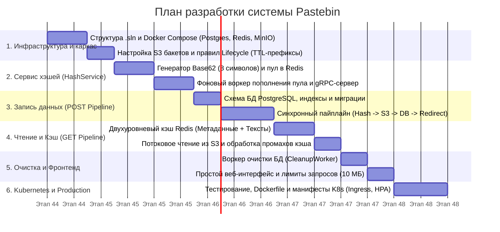

# Роадмап разработки проекта Pastebin

Данный документ описывает пошаговый план реализации высокопроизводительного сервиса временного хранения текстовых блоков (до $10\text{ МБ}$) на стеке **C# (.NET 8), PostgreSQL, Redis, Amazon S3, Docker и Kubernetes**.

---

## Обзор этапов (Milestones)

---

## Этап 1. Подготовка инфраструктуры и каркаса решения

**Цель:** Создать базовую структуру проектов C# и настроить локальное окружение для разработки, полностью имитирующее облачную инфраструктуру.

- [ ] **Инициализация решения (`Pastebin.sln`):**
  - Создание проектов `Pastebin.MainService`, `Pastebin.HashService`, `Pastebin.CleanupWorker` и общей библиотеки `Pastebin.Shared`.
  - Настройка единого стиля логирования (Serilog) и конфигурации через переменные окружения.
- [ ] **Локальное окружение (`docker-compose.yml`):**
  - Поднятие контейнеров с **PostgreSQL** и **Redis**.
  - Поднятие **MinIO** (или LocalStack) в качестве локального S3-совместимого хранилища.
- [ ] **Конфигурация хранилища S3:**
  - Создание бакета для хранения записей.
  - Настройка правил жизненного цикла (**S3 Lifecycle Configuration**) для автоматического удаления объектов по префиксам (`ttl-1h/`, `ttl-1d/`, `ttl-7d/`).

---

## Этап 2. Реализация сервиса генерации хэшей (`Pastebin.HashService`)

**Цель:** Обеспечить быструю, потокобезопасную и бесперебойную выдачу уникальных 8-значных хэшей по алгоритму Base62.

- [ ] **Ядро генерации Base62:**
  - Реализация алгоритма генерации 8-значных строк из алфавита `[0-9, a-z, A-Z]` (емкость $62^8 \approx 2.18 \times 10^{14}$ комбинаций).
  - Написание модульных тестов на уникальность, длину и корректность символов.
- [ ] **Работа с кэшем хэшей в Redis:**
  - Реализация атомарного извлечения хэшей из Redis Set со сложностью $O(1)$ с помощью команды `SPOP`.
  - Добавление локального потокобезопасного буфера в памяти (`ConcurrentQueue<string>` / `System.Threading.Channels`) для пакетной выгрузки из Redis и снижения сетевых накладных расходов при пиковых нагрузках.
- [ ] **Фоновое пополнение пула (`PoolReplenishWorker`):**
  - Реализация `BackgroundService`, отслеживающего текущий размер пула свободных хэшей (`SCARD`).
  - Настройка многопоточной догенерации новых пачек хэшей (`SADD`) при падении количества ключей ниже минимального порога (например, $< 10\,000$ штук).
  - Добавление распределенной блокировки (Redlock) в Redis, чтобы несколько реплик `HashService` в Kubernetes не генерировали хэши одновременно.
- [ ] **gRPC-интерфейс:**
  - Описание контракта `hash_generator.proto` в проекте `Pastebin.Shared`.
  - Реализация gRPC-эндпоинта выдачи хэша для основного сервиса.

---

## Этап 3. Основной сервис: БД и синхронный пайплайн записи (`POST`)

**Цель:** Реализовать надежное сохранение текста до $10\text{ МБ}$ со строгой синхронной последовательностью, исключающей ошибки `404` при редиректе и `500` при сбое S3.

- [ ] **Схема базы данных PostgreSQL:**
  - Создание таблицы `pastes` (`id`, `hash`, `s3_bucket`, `s3_key`, `size_bytes`, `content_type`, `created_at`, `expires_at`).
  - Добавление уникального индекса по полю `hash` и индекса по времени истечения `expires_at`.
  - Настройка миграций БД при старте или в init-контейнере.
- [ ] **Интеграция с Amazon S3:**
  - Реализация сервиса загрузки текста в S3 с выбором префикса ключа (`ttl-1h/{hash}`, `ttl-1d/{hash}`, `ttl-7d/{hash}`) на основе выбранного пользователем времени жизни.
  - Стриминг данных (потоковая передача без полной буферизации массива байт в LOH памяти .NET) и сжатие текста на лету (Gzip/Brotli) для экономии места и трафика.
- [ ] **Синхронный оркестратор `POST /api/pastes`:**
  1. Валидация входного запроса (проверка размера $\le 10\text{ МБ}$ и допустимого TTL).
  2. Синхронный запрос свободного 8-значного хэша у `Pastebin.HashService` по gRPC.
  3. Синхронная отправка текста в S3 и получение метаданных (`s3_key`, `ETag`, размер).
  4. Синхронная запись хэша, времени истечения и метаданных S3 в PostgreSQL.
  5. Возврат `HTTP 302 Redirect` (или `303 See Other`) на страницу `/hash_code`.
- [ ] **Обработка нештатных ситуаций:**
  - При ошибке записи в S3 — прерывание пайплайна без записи в БД и возврат ошибки клиенту (возврат неиспользованного хэша обратно в пул).
  - При ошибке записи в БД после загрузки в S3 — возврат ошибки клиенту (файл-сирота в S3 автоматически удалится по правилу Lifecycle префикса).

---

## Этап 4. Пайплайн чтения (`GET`) и двухуровневое кэширование

**Цель:** Обеспечить минимальную задержку при чтении популярных записей и разгрузить PostgreSQL и S3.

- [ ] **Уровень 1 — Кэш часто используемых хэшей (Metadata Cache в Redis):**
  - При запросе `GET /{hash}` проверка наличия ключа `meta:{hash}` в Redis.
  - При промахе кэша (Cache Miss) — запрос метаданных из PostgreSQL с обязательным условием `expires_at > NOW()`.
  - Если запись не найдена или истекла — возврат `HTTP 404 Not Found` (плюс короткое кэширование отрицательного результата на $1\text{–}2\text{ минуты}$ для защиты БД от перебора ссылок).
  - Сохранение найденных метаданных в Redis с TTL, не превышающим оставшееся время жизни записи:
    $$\text{TTL}_{\text{cache}} = \min(\text{DefaultMetaTTL}, \text{expires\_at} - \text{NOW}())$$
- [ ] **Уровень 2 — Кэш часто используемых записей (Content Cache в Redis):**
  - По полученному из метаданных `s3_key` проверка наличия самого текста в Redis (`text:{s3_key}`).
  - Введение порога размера для кэширования текста в Redis (например, кэшировать в оперативной памяти тексты до $256\text{ КБ} \text{ – } 1\text{ МБ}$ или только при повторных запросах), чтобы одиночные чтения $10\text{ МБ}$ файлов не вымывали весь кэш Redis.
  - При промахе кэша — потоковое чтение объекта из Amazon S3, возврат пользователю и сохранение в кэш текстов.
- [ ] **Защита от Cache Stampede:**
  - Использование блокировки на уровне запроса (SingleFlight / `Lazy<Task>`) при одновременном обращении множества клиентов к одному и тому же популярному хэшу в момент истечения его кэша.

---

## Этап 5. Фоновая очистка данных и пользовательский интерфейс

**Цель:** Реализовать автоматическое удаление просроченных данных из всех узлов системы и предоставить простой интерфейс для пользователей.

- [ ] **Воркер очистки БД (`Pastebin.CleanupWorker`):**
  - Реализация фонового цикла на базе `PeriodicTimer`.
  - Пакетное удаление истекших записей (`DELETE ... WHERE expires_at <= NOW()`) батчами по $1000$ строк с использованием конструкции `FOR UPDATE SKIP LOCKED` для избежания блокировок таблицы.
- [ ] **Конфигурация политик вытеснения Redis:**
  - Настройка параметров `maxmemory` и политики вытеснения (`volatile-lfu` или `allkeys-lru`) для автоматической очистки памяти внутренними механизмами Redis.
- [ ] **Минималистичный фронтенд (`wwwroot`):**
  - Главная страница (`index.html`): текстовое поле, выбор времени жизни записи (`1 час`, `1 день`, `7 дней`), индикатор размера текста и кнопка отправки.
  - Страница просмотра (`/{hash}`): чистое отображение текста, кнопка «Скопировать в буфер», отображение времени до удаления и ссылка на скачивание Raw-текста (`GET /raw/{hash}`).
- [ ] **Защита публичного API (без авторизации):**
  - Жесткое ограничение `MaxRequestBodySize = 10_485_760` ($10\text{ МБ}$) в настройках веб-сервера Kestrel.
  - Подключение встроенного `RateLimiter` в ASP.NET Core (ограничение количества `POST`-запросов с одного IP-адреса).

---

## Этап 6. Контейнеризация, тестирование и деплой в Kubernetes

**Цель:** Упаковать все компоненты в контейнеры, проверить систему под нагрузкой и подготовить к запуску в кластере Kubernetes.

- [ ] **Оптимизация Docker-образов:**
  - Написание многоступенчатых (multi-stage) `Dockerfile` для `MainService`, `HashService` и `CleanupWorker` на базе легковесных образов `mcr.microsoft.com/dotnet/aspnet:8.0-alpine`.
- [ ] **Интеграционное и нагрузочное тестирование:**
  - Интеграционные тесты полного цикла `POST -> Redirect -> GET -> Expiration` с использованием `Testcontainers`.
  - Нагрузочное тестирование (k6 / NBomber): проверка отсутствия коллизий при параллельном запросе тысяч хэшей и стабильности при передаче блоков по $10\text{ МБ}$.
- [ ] **Манифесты Kubernetes (`deploy/k8s/`):**
  - Создание `Deployment` и `Service` для всех сервисов.
  - Настройка проб живучести и готовности (`livenessProbe`, `readinessProbe`) в ASP.NET Core (`/healthz`).
  - Конфигурация `Ingress` с обязательной аннотацией `nginx.ingress.kubernetes.io/proxy-body-size: "10m"`.
  - Настройка `HorizontalPodAutoscaler` (HPA) для автоматического масштабирования подов `MainService` и `HashService` по нагрузке на CPU/RAM.

---

## Критерии готовности системы (Definition of Done)

1. Пользователь может отправить текст размером до $10\text{ МБ}$, выбрать TTL и синхронно перейти по 8-значной ссылке `/hash_code`, сразу увидев свой текст без ошибок `404` или `500`.
2. При недоступности S3 запись в БД не создается, а пользователь получает корректное уведомление об ошибке.
3. Повторные `GET`-запросы к популярным ссылкам обслуживаются напрямую из кэшей Redis без обращений к PostgreSQL и S3.
4. После истечения выбранного времени жизни запись становится недоступной по ссылке, автоматически исчезает из Redis, удаляется воркером из PostgreSQL и очищается правилами Lifecycle в S3.
5. Вся система разворачивается одной командой локально (`docker-compose up`) и готова к деплою в Kubernetes (`kubectl apply -f deploy/k8s/`).